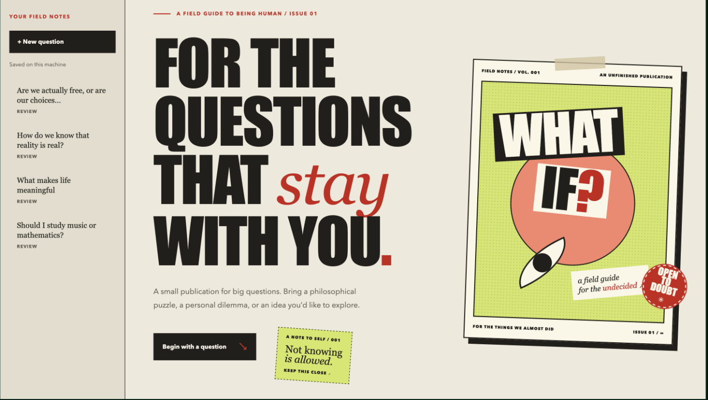
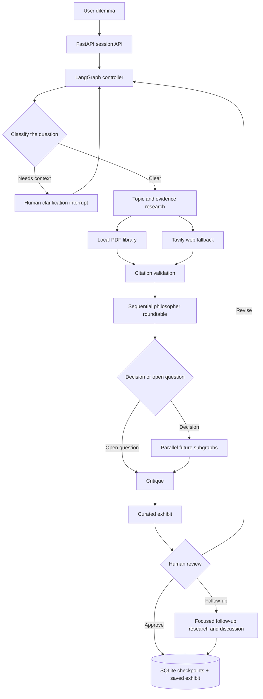
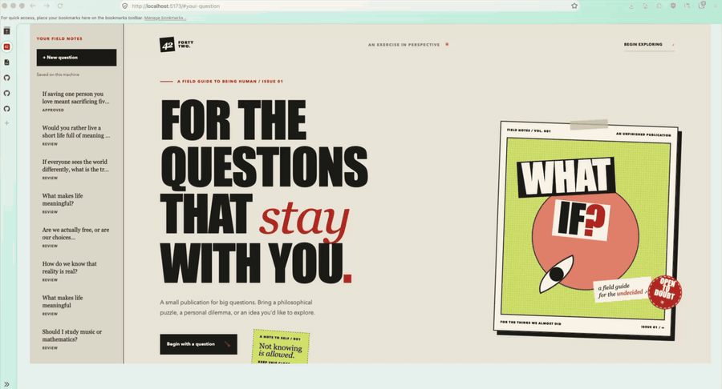

# 42

### An agentic AI philosophy studio for thinking through life's difficult choices

**42** is a local-first decision-support application that combines LangGraph,
retrieval-augmented generation, structured model outputs, and human-in-the-loop
review. It turns a dilemma into grounded philosophical perspectives, contrasts
possible futures, and saves a reviewed exhibit for reflection.

[](https://www.python.org/)
[](https://fastapi.tiangolo.com/)
[](https://langchain-ai.github.io/langgraph/)
[](https://react.dev/)
[](https://ollama.com/)
[](#license)

> **AI-generated voices are interpretations, not quotations.** The future
> letters are fictional narratives and not predictions or professional advice.

<p align="center">
  
</p>

---

<!-- Demo: add docs/demo.gif or assets/demo.gif here after recording. -->

## Why 42 stands out

- **A real multi-stage agent system:** Uses conditional routing, subgraphs,
  parallel future generation, structured outputs, interruptions, and resume
  semantics rather than a single prompt.
- **Grounded, citation-aware responses:** Searches a local library first,
  validates that generated excerpts appear in retrieved passages, and falls
  back to web research only when local evidence is insufficient.
- **Human control by design:** Pauses for clarification, lets users revise or
  approve the final exhibit, supports follow-up questions, and persists session
  state across API restarts.
- **Privacy-conscious architecture:** Dilemmas and source passages stay local
  through Ollama. Tavily is used only for fixed topic research queries and
  selected web extraction.
- **Built for observable reasoning:** Streams node progress and trace events
  to the interface so users can see where the workflow is moving and which
  sources informed the result.
- **Tested agent contracts:** Unit and integration coverage exercises routing,
  citations, checkpoints, follow-ups, restart recovery, local retrieval, and
  API file-safety behavior.

## The experience

1. **Share a question** — enter an open reflection or a choice with two paths.
2. **Clarify when necessary** — the graph pauses if the question needs more context.
3. **Research the topic** — search curated local PDFs first, then use web
   fallback when warranted.
4. **Stage an interpretation** — multiple AI perspectives respond sequentially
   and a moderator distills tensions and agreements.
5. **Explore possible futures** — for a clear decision, generate two independent,
   fictional letters grounded in the gathered evidence.
6. **Review, revise, or approve** — submit critique before the exhibit is saved.
7. **Continue the conversation** — ask follow-ups without rewriting the original
   future letters.

## System architecture



### Core components

| Component | Responsibility |
| --- | --- |
| `fortytwo/graph.py` | Main LangGraph workflow, routing, review interrupts, and exhibit creation |
| `fortytwo/research.py` | Local-author discovery, relevance checks, Tavily search, and extraction |
| `fortytwo/library.py` | PDF extraction, chunking, embeddings, Chroma index, and passage retrieval |
| `fortytwo/roundtable.py` | Sequential interpretations and moderator distillation |
| `fortytwo/futures.py` | Parallel fictional future-letter subgraphs |
| `fortytwo/retrieval.py` | Citation and source-grounding validation |
| `api.py` | Durable FastAPI sessions, trace events, follow-ups, and exhibit storage |
| `frontend/` | React interface for live progress, review, follow-ups, and source browsing |

## Engineering highlights

### Agent orchestration

The workflow is not a linear chatbot loop. LangGraph coordinates research,
clarification, roundtable discussion, critic review, revision, exhibit curation,
human approval, and follow-up branches. SQLite checkpointers preserve state,
allowing paused conversations to resume after a restart.

### Retrieval quality and safeguards

- Local passages are prioritized over web search.
- Evidence is filtered for topical relevance and author diversity.
- Structured Pydantic outputs constrain routing and model-generated artifacts.
- A critic checks unsupported claims and citation validity.
- Generated citations must resolve to exact retrieved passage text.

### Traceable execution

The API exposes session status and ordered trace events. The frontend renders
workflow stages as they complete, making the system understandable and easier
to debug than an opaque chat response.

## Tech stack

| Area | Technology |
| --- | --- |
| Agent orchestration | LangGraph |
| Model integration | LangChain Ollama |
| Structured outputs | Pydantic |
| Local language model | Ollama with `qwen3.5:4b` |
| Local embeddings | `nomic-embed-text` |
| Vector search | ChromaDB |
| PDF processing | PyPDF |
| Web research fallback | Tavily Search and Extract |
| API | FastAPI, Uvicorn |
| State and sessions | SQLite |
| Frontend | React 19, Vite |

## Quick start

### Prerequisites

- Python 3.13
- [uv](https://docs.astral.sh/uv/getting-started/installation/)
- [Ollama](https://ollama.com/)
- Node.js 22.12+ or 24+
- A Tavily API key for web fallback

### 1. Install the local models

```bash
ollama serve
ollama pull qwen3.5:4b
ollama pull nomic-embed-text
```

### 2. Configure the backend

```bash
uv sync
```

Create `.env` if it does not exist, then add your key:

```dotenv
TAVILY_API_KEY=your_api_key
```

### 3. Index the bundled library

The repository includes philosophical PDFs. With Ollama running, build or
rebuild the local index:

```bash
uv run python -m fortytwo.library
```

### 4. Start the application

Terminal 1 — API:

```bash
uv run --env-file .env uvicorn api:app --host 127.0.0.1 --port 8000
```

Terminal 2 — frontend:

```bash
cd frontend
npm install
npm run dev
```

Open `http://127.0.0.1:5173`.

## Testing

Run the Python suite:

```bash
uv run python -m unittest -v \
  test_api test_graph test_library test_local_research test_futures
```

Check the frontend:

```bash
cd frontend
npm run lint
npm run build
```

The `test_api` suite uses an isolated temporary SQLite database. Core graph
tests replace external models and services with deterministic fakes, so they
validate orchestration and contracts without making a live model call.

## Manual evaluation

Passing unit tests establish software behavior; they do not establish quality
of local model output. Use the small human-review set in
[evaluation/README.md](evaluation/README.md) to inspect relevance, citation
accuracy, interpretation quality, latency, and failures.

The evaluation explicitly treats its scoring set as a manual review aid, not a
validated quality benchmark.

## Privacy and limitations

- Personal prompts and local Ollama responses are processed locally.
- Tavily receives fixed topic queries, catalogued thinker names, and selected
  URLs. Prompt details may still be disclosed through topic routing.
- Checkpoints, trace events, source text, drafts, and exhibits are stored
  under `.data/` and `exhibits/`; they are not encrypted by the application.
- Do not enter sensitive personal information or commit personal sessions,
  questions, or reviewer notes.
- The philosophical voices are AI interpretations and may be inaccurate or
  unbalanced.
- The system is for reflection and exploration, not legal, medical, financial,
  or psychological advice.
- CPU-only local inference may be slow; output quality varies by model and source.

## Repository guide

```text
fortytwo/       Agent graphs, prompts, retrieval, and evidence validation
frontend/       React interface
library/        Source PDFs and the source catalog
evaluation/     Human-scored scenarios and result template
test_*.py       API, graph, retrieval, and library tests
api.py          FastAPI application
```

## Project story

This repository started as a guided systems-building exercise and grew into a
complete reference application. Its core engineering lesson is that a useful
agentic product should combine four things:

1. A model for flexible interpretation
2. Determinable workflows and validation
3. Persistent state and human checkpoints
4. Sources and limitations that users can inspect

## Demo

<p align="center">
  
</p>

## License

Add a license file before publishing or accepting contributions. Until a license
is included, the repository should be treated as source-available for portfolio
review, not as a grant of reuse rights.

---

<p align="center">
  <strong>Built to make AI agents inspectable, grounded, interruptible, and human-reviewed.</strong>
</p>